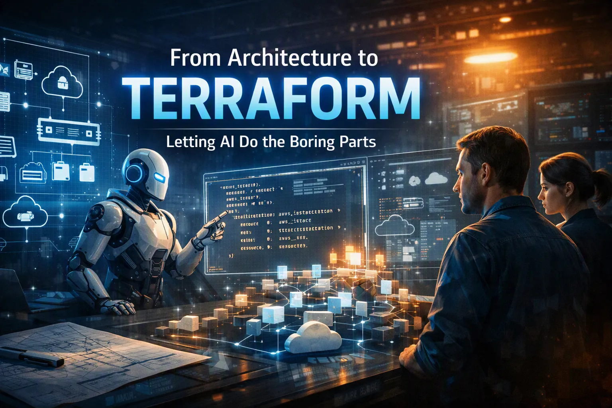

 🗣️Talk 🟢 Intermediate

## Short Abstract
Most cloud architectures follow familiar patterns, yet teams still hand‑assemble Terraform for each service. This session shows how architecture docs can be transformed into a machine‑readable YAML contract, how opinionated modules enforce standards, and how AI can interpret intent without generating code. Through a live end‑to‑end demo, you’ll see how AI identifies components, where it’s intentionally constrained, and how deterministic scripts produce consistent, governed Terraform. Attendees leave with a practical model that reduces repetition, accelerates delivery, and frees engineers to focus on higher‑value architectural decisions.

## Abstract
Most cloud services follow the same architectural patterns, yet engineers still hand‑assemble Terraform code for each of them. In this session, based on real work done in production, you’ll see how documented architecture can become a machine‑readable contract, how opinionated modules act as guardrails, and how AI can handle the repetitive translation work without replacing human judgment.

We’ll walk through a live, end‑to‑end demo that starts with a documented service architecture and ends with Terraform generated through a constrained module library. You’ll see what the AI gets right, where it’s intentionally limited, and how engineers review and refine the output to ensure standards, governance, and intent are preserved. 

You’ll leave with a practical model for encoding architectural decisions so AI can reliably interpret them, a repeatable pattern for building and using opinionated modules that enforce consistency, and a human‑in‑the‑loop workflow that keeps engineers accountable while freeing them from low‑value assembly work. This isn’t “AI writes Terraform.” It’s a shift in how platform teams standardize infrastructure, reduce repetition, and focus engineering effort where it matters most.

# Type
- 45/60/75-minute session

## Tags
     

## Learning Objectives

- **Understand why AI excels at interpreting architecture intent but fails at deterministic Terraform generation**, and why this distinction is critical for governed infrastructure.
- **Learn how to convert human‑written architecture documentation into a machine‑readable YAML contract** that encodes naming, modules, parameters, and governance rules.
- **Apply a two‑stage pipeline—AI for interpretation, deterministic scripts for generation—to produce consistent, standards‑aligned Terraform at scale**, reducing delivery time from weeks to days.

## Presentations

| Event | Location | Date | Time | Room | Downloads |
|-------|:--------:|-----:|-----:|-----:|----------:|
| Momentum Developer Conference | Cincinnati, OH | 2026-10-15 | 11:25 EDT | Ballroom A | Available Afterwards |
| AI Rising | Columbus, OH | 2026-10-20 | 10:10 EDT | Greate Hall Meeting Room 3 | Available Afterwards |

Email [chadgreen@chadgreen.com](mailto:chadgreen@chadgreen.com?subject=Presentation%20Request:%20Presentation%20Title) to have Chad present this session at your event.
